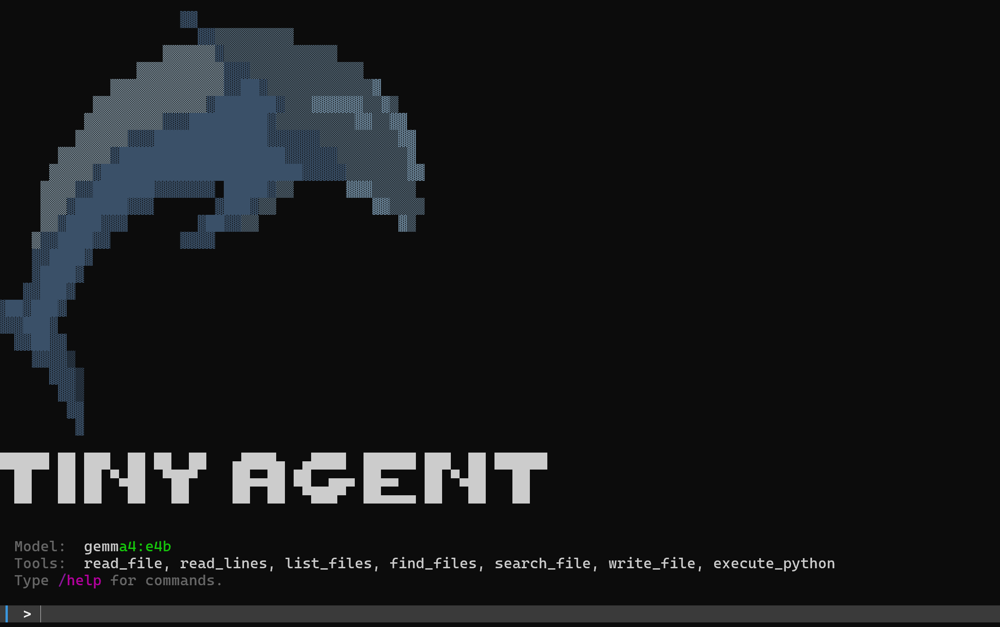

この書籍では、各章で扱う理論的な背景をもとに、なぜ特定のコンポーネントが必要なのか、また、それぞれにどのような機能があるのかを理解しながら、段階的に `TinyAgent` を構築していきます。今回は、このハンズオン形式のアプローチを **pure Python** で実践することにしました！

OpenAI-compatible endpoint 上で動作し、リクエストを送信できる LLM が用意されていることを前提としています。それ以外は、すべて Python のみで構築します。また、MCP などの dependencies を利用するサンプルも用意していますが、これらは完全に任意であり、追加コンテンツとして扱っています。

# Setting up your environment

環境を構築する方法はいくつかあります。以下から、自分に合った方法を選択してください（使用する方法のコメントアウトを解除してください）。

### pip

すでに Python 3.9 以降の Python 環境がある場合は、以下のコマンドで dependencies をインストールできます。

```bash
# notebook のチュートリアルを進める場合
pip install illustrated-agents[jupyter]

# CLI で TinyAgent を使用する場合
pip install illustrated-agents[terminal]
```

GitHub リポジトリから直接パッケージをインストールすることもできます。

```
pip install git+https://github.com/HandsOnLLM/An-Illustrated-Guide-To-AI-Agents.git
```

### uv

私たちが推奨する環境構築・管理方法は [`uv`](https://github.com/astral-sh/uv) です。[こちらの手順](https://docs.astral.sh/uv/getting-started/installation/)でインストールできます。使い方もシンプルです。

```bash
# notebook のチュートリアルを進める場合
uv add illustrated-agents --extra jupyter

# CLI で TinyAgent を使用する場合
uv add illustrated-agents
```

または、リポジトリを clone 済みの場合は、以下のコマンドを実行します。

```bash
# notebook のチュートリアルを進める場合
uv sync --extra jupyter

# CLI で TinyAgent を使用する場合
uv sync
```

## `TinyAgent` in the command line

コマンドラインから `TinyAgent` を使用するには、以下のように `uv` を使って tool としてインストールします。

```bash
uv tool install illustrated-agents[cli]
```

これにより、ターミナルから以下の1つのコマンドだけで `TinyAgent` を実行できるようになります。

```bash
tinyagent
```



# Chapters

各章のチュートリアルは、以下の方法で実行できます。

* `Google Colab` -- 環境構築の手間を大幅に省けるクラウド環境
* `Jupyter Lab` -- notebook を使用するローカルの開発環境

### Google Colab

`Google Colab` は、notebook（Jupyter Lab と同様の形式）を使用して、各章のサンプルを実行できるクラウド環境です。

書籍内のすべての `.ipynb` ファイルは、ローカル環境と Google Colab の両方で実行できます。

[Open In Colab](https://colab.research.google.com/assets/colab-badge.svg)

&#x20;ボタンをクリックすると、notebook が開き、そのまま実行できます。

### **Jupyter Lab**

各章のチュートリアルでは、notebook が主要な教材となっており、Agents の基礎を順を追って学べるようになっています。
Jupyter Lab は一般的に利用されているアプリケーションで、以下のコマンドで起動できます。

```bash
# uv を使用する場合
uv run jupyter lab

# Python を直接使用する場合
jupyter lab
```
