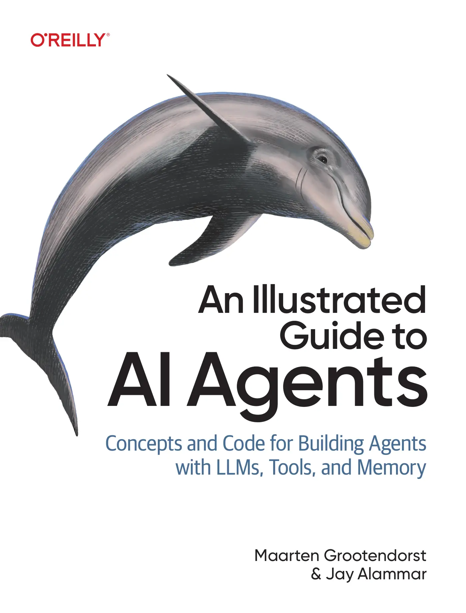
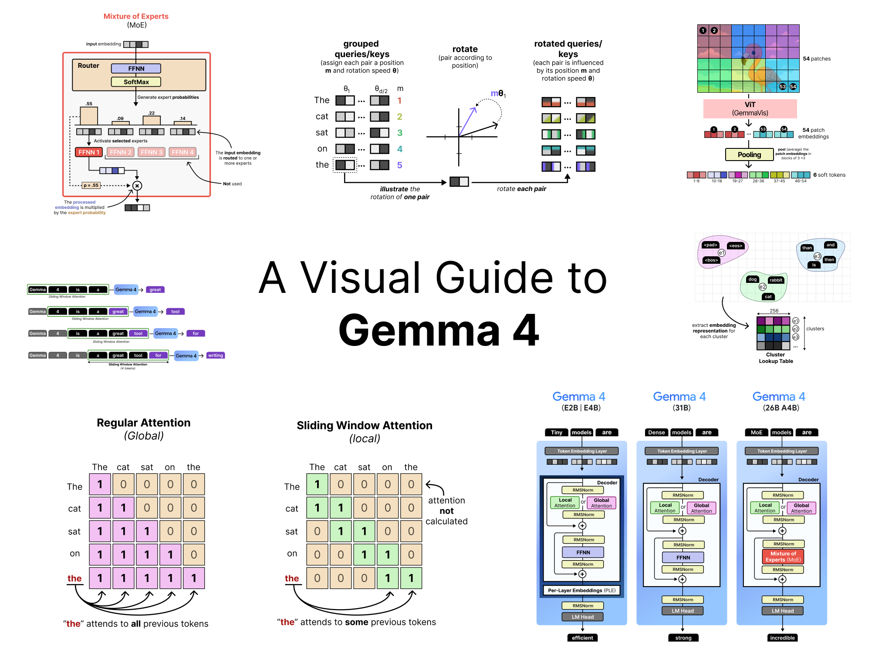
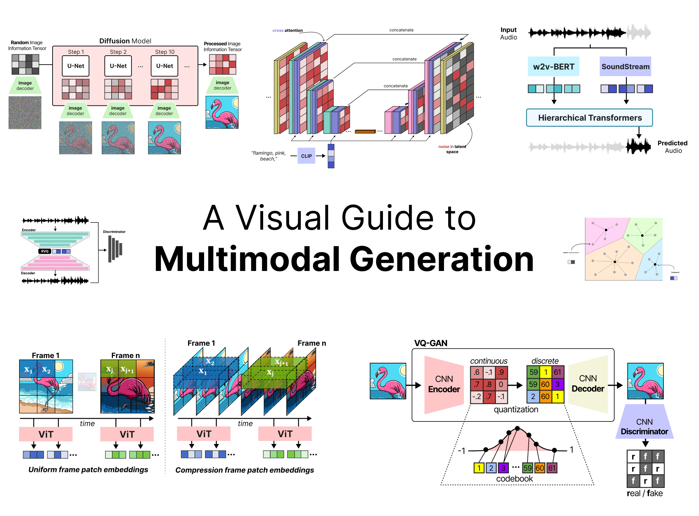
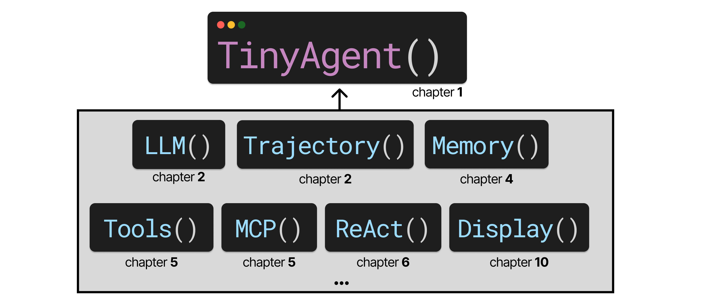
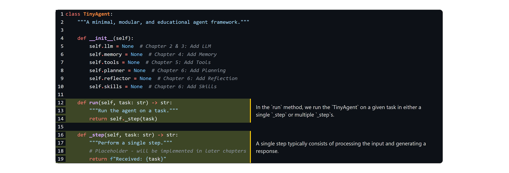
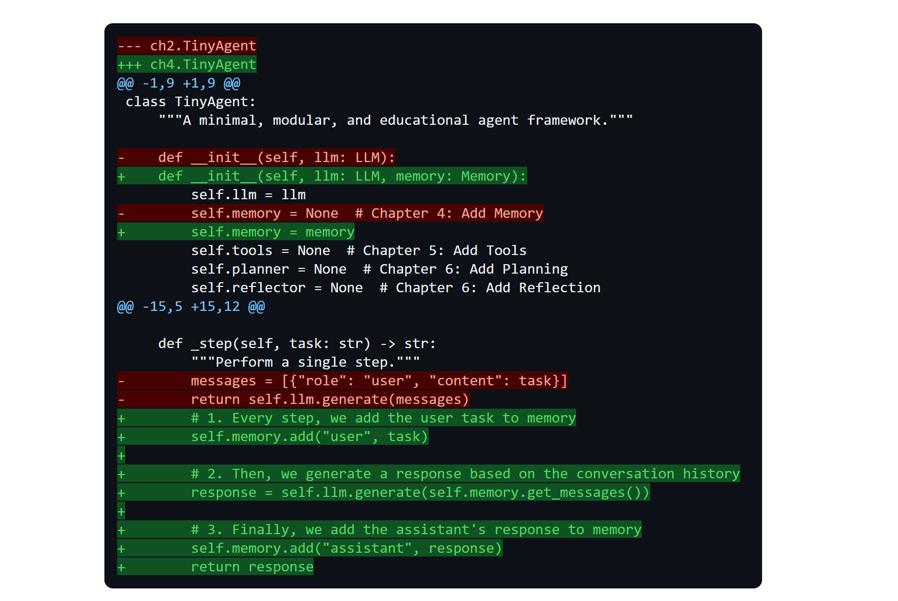

# AIエージェント図解ガイド

<a href="https://www.linkedin.com/in/mgrootendorst/"></a>
<a href="https://www.linkedin.com/in/jalammar/"></a>
[](https://pypi.org/project/illustrated-agents/)

ようこそ！ここでは、[Maarten Grootendorst](https://www.linkedin.com/in/mgrootendorst/) と [Jay Alammar](https://www.linkedin.com/in/jalammar/) によって執筆された書籍 [An Illustrated Guide to AI Agents](https://www.amazon.com/Illustrated-Guide-AI-Agents-Concepts/dp/B0GTYL2QSJ) のコードを公開しています。このリポジトリでは、次のことを学べます。

<p align="center"><b><i>「ゼロから Agent を構築しよう！」</i></b></p>

本書では、視覚的に理解しやすい解説と **300点以上のオリジナル図解** を通じて、現在の AI Agents を活用するために必要な実践的なツールや概念を学ぶことができます。



<br>

## Table of Contents - Build a `TinyAgent` from Scratch!

このリポジトリのコード例は、LLM の呼び出しだけを使って、完全にゼロから `TinyAgent` を構築できるように用意されています。Memory、Tools、Autonomy を備えた独自の Agent を作成する方法を学べます！

すべてのサンプルは、Google Colab の T4 GPU を使用して **無料** で実行できます。追加費用をかけることなく、ローカル環境またはクラウド環境のどちらでも実行できます。

| Chapter                                   | Notebook                                                                                                                                                                                                |
| ----------------------------------------- | ------------------------------------------------------------------------------------------------------------------------------------------------------------------------------------------------------- |
| 1章：導入部                               | [](https://colab.research.google.com/github/HandsOnLLM/An-Illustrated-Guide-To-AI-Agents/blob/main/chapter01/chapter01.ipynb) |
| 2章：大規模言語モデル                     | [](https://colab.research.google.com/github/HandsOnLLM/An-Illustrated-Guide-To-AI-Agents/blob/main/chapter02/chapter02.ipynb) |
| 3章：大規模言語モデルの推論               | [](https://colab.research.google.com/github/HandsOnLLM/An-Illustrated-Guide-To-AI-Agents/blob/main/chapter03/chapter03.ipynb) |
| 4章：記憶                                 | [](https://colab.research.google.com/github/HandsOnLLM/An-Illustrated-Guide-To-AI-Agents/blob/main/chapter04/chapter04.ipynb) |
| 5章：ツールの使用、学習、およびプロトコル | [](https://colab.research.google.com/github/HandsOnLLM/An-Illustrated-Guide-To-AI-Agents/blob/main/chapter05/chapter05.ipynb) |
| 6章：計画と内省                           | [](https://colab.research.google.com/github/HandsOnLLM/An-Illustrated-Guide-To-AI-Agents/blob/main/chapter06/chapter06.ipynb) |
| 7章：エージェントの評価                   | [](https://colab.research.google.com/github/HandsOnLLM/An-Illustrated-Guide-To-AI-Agents/blob/main/chapter07/chapter07.ipynb) |
| 8章：マルチエージェントシステム           | [](https://colab.research.google.com/github/HandsOnLLM/An-Illustrated-Guide-To-AI-Agents/blob/main/chapter08/chapter08.ipynb) |
| 9章：マルチモーダル理解                   | [](https://colab.research.google.com/github/HandsOnLLM/An-Illustrated-Guide-To-AI-Agents/blob/main/chapter09/chapter09.ipynb) |
| 10章：エージェントとLLMsのコーディング    | [](https://colab.research.google.com/github/HandsOnLLM/An-Illustrated-Guide-To-AI-Agents/blob/main/chapter10/chapter10.ipynb) |

> [!TIP]
> ローカル環境に必要なすべてのパッケージをインストールするためのクイックスタートガイドは、[setup](.setup/) フォルダを確認してください。

## Reviews

> "_著者たちは卓越した開発者であり、本書は彼らの深い知識を証明するものです。豊富な図解と実践的な TinyAgent の演習によって、概念を親しみやすく、直感的に、そして楽しく学べるようになっています。_"
>
> **Chip Huyen** - [AI Engineering](https://www.oreilly.com/library/view/ai-engineering/9781098166298/) および [Designing Machine Learning Systems](https://www.oreilly.com/library/view/designing-machine-learning/9781098107956/) の著者

---

> "_AI システムの教え方についてはこれまで多くのことを考えてきましたが、本書には、現代の AI Agents という広大な領域を、図解によってこれほど明快に説明できるのかと驚かされました。Maarten と Jay は、この急速に進化する分野における普遍的な概念を見極め、わかりやすく説明するという素晴らしい仕事をしています。現代の Agent の仕組みや構築方法を理解したい人に、私が最初に薦める一冊になると思います。_"
>
> **Omar Khattab** - MIT EECS 准教授

---

> "_Grootendorst と Alammar は、Tokenization から Multi-Agent Systems まで、AI Agent の技術スタック全体を、魅力的なビジュアル形式で解説しています。この分野が進化し続ける中でも、本書はテーマを非常に網羅的に扱っているため、今後も有用なリファレンスとして活用できるでしょう。_"
>
> **Ofir Press** - Meta FAIR の Research Scientist、SWE-bench および SWE-agent の共同著者

---

## [Bonus content!](bonus/)

本書では、読者にとって情報過多にならない範囲で、できる限り多くの情報を盛り込むことを目指しました。しかし、300点以上の図解を収録していても、まだまだ掘り下げるべきテーマはたくさんあります。

本書の内容を補完し、新しく [興味深いトピック](bonus/) をさらに深く解説するため、無料のビジュアルガイドも継続的に制作しています。

|                            [Gemma 4 のビジュアルガイド](https://newsletter.maartengrootendorst.com/p/a-visual-guide-to-gemma-4)                             |                                   [Multimodal Generation のビジュアルガイド](https://newsletter.maartengrootendorst.com/p/a-visual-guide-to-multimodal-generation)                                    |
| :---------------------------------------------------------------------------------------------------------------------------------------------------------: | :---------------------------------------------------------------------------------------------------------------------------------------------------------------------------------------------------: |
| [](https://newsletter.maartengrootendorst.com/p/a-visual-guide-to-gemma-4) | [](https://newsletter.maartengrootendorst.com/p/a-visual-guide-to-multimodal-generation) |

## A Unique Way of Learning

今回は特別な取り組みとして、読者自身が **ゼロから Agent を構築できる** ようにしたいと考えました。

さらに、単に Agent を構築するだけでなく、学習効果を高めるために、構築プロセスそのものをモジュール化された体験にすることを目指しました。

コンポーネントを一度に一つずつ段階的に追加していくことで、Agent が実際にどのように動作するのかを、より直感的に理解できるようになります。


また、各コンポーネントを追加することで何が起きるのか、それが `TinyAgent` にどのような影響を与えるのかを説明するために、独自の工夫を凝らした解説方法も取り入れました。



モジュール性を重視した設計思想に基づき、各章では一つのテーマを明確に扱えるようにしています。

そのため、特定のコード行がなぜ必要なのかを理解できるよう、コードに注釈を付けるといった工夫も可能になっています。



`TinyAgent` を段階的に構築していく過程では、章によって多くのコード変更が発生することがあります。

こうした変更が `TinyAgent` に与える影響をわかりやすく示し、学習のハードルを下げるために、diff を活用しています。



## Citation

研究などで本書が役立った場合は、以下の形式で引用していただけると幸いです。

```
@book{illustrated-agents-book,
  author       = {Maarten Grootendorst and Jay Alammar},
  title        = {An Illustrated Guide to AI Agents},
  publisher    = {O'Reilly},
  year         = {2026},
  isbn         = {979-8341662698},
  url          = {https://www.oreilly.com/library/view/an-illustrated-guide/9798341662681/},
  github       = {https://github.com/HandsOnLLM/An-Illustrated-Guide-To-AI-Agents}
}
```
